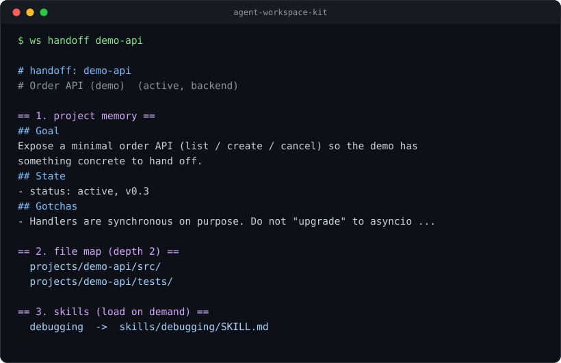

# agent-workspace-kit

**AI agent 换个会话就把一切忘光。这套东西给它一份能活过会话的记忆：一个 JSON 索引 + 每个项目一份六段式「接管包」——任何 agent 一条命令就能接上手。**

[](https://github.com/wenliangliu05/agent-workspace-kit/actions/workflows/ci.yml)
[](LICENSE)


不用服务、不用数据库、没有第三方依赖：一个 JSON 文件、若干 Markdown、一个只用标准库的 Python CLI。



---

## 问题

新会话，熟悉的对话：

> **你：** 接着上周那个导入脚本做。
> **Agent：** 哪个项目？现在什么状态？之前试过什么？

于是它开始 `ls`、`tree`、`grep`，打开五个文件，把你周二已经定下的决定重新推一遍，偶尔还把你周三刚修好的 bug 再引回来一次。**文件从来不是问题，上下文才是。**

## 思路

| 原则 | 落地 |
| --- | --- |
| **id 稳定** | 项目创建时拿到 `demo-api` 这样的 id，之后永不改变；改标题不牵动任何其他东西 |
| **要留就立项** | 需要活过会话的东西 → `projects/<id>/` + 一份接管包，而不是根目录里的散文件 |
| **一个入口** | `ws.py find` / `ws.py handoff`，取代 `ls` + `find` + `cat` 的考古 |

## 安装

不用编译，也没有依赖要解析。

```bash
# 装成机器上随处可用的命令（推荐）
pipx install git+https://github.com/wenliangliu05/agent-workspace-kit

# 或者在 venv 里用 pip
python3 -m venv .venv
.venv/bin/pip install git+https://github.com/wenliangliu05/agent-workspace-kit
```

装好后只有一个命令：

```bash
ws init ~/my-workspace     # 建一个工作区
ws handoff demo-api        # 在工作区里问：动它之前我需要知道什么？
ws --version
```

一点都不想装也行——直接 clone 本仓库，它本身就是一个能跑的工作区（见下一节）。

## 60 秒试用

本仓库**本身就是一个可用的工作区**（内含两个示例项目），不需要安装任何东西：

```bash
git clone https://github.com/wenliangliu05/agent-workspace-kit
cd agent-workspace-kit
python3 assets/tools/ws.py handoff demo-api
```

输出（节选）：

```
# handoff: demo-api
# Order API (demo)  (active, backend)

== 1. project memory ==
## Goal
Expose a minimal order API (list / create / cancel) ...
## State
- status: active, v0.3
## Gotchas
- Handlers are synchronous on purpose. Do not "upgrade" to asyncio ...

== 2. file map (depth 2) ==
  projects/demo-api/src/
  projects/demo-api/tests/

== 3. skills (load on demand) ==
  debugging  ->  skills/debugging/SKILL.md
```

这就是全部接管信息：这个项目是什么、现在到哪一步、该去哪看、什么会咬人、下一步做什么。

## 建自己的工作区

```bash
python3 assets/tools/ws.py init ~/my-workspace --title "我的工作区"
cd ~/my-workspace

python3 assets/tools/ws.py new "发票导入器" --type backend --stack python --tag etl
# 然后填 projects/invoice-importer/project_memory.md

python3 assets/tools/ws.py handoff invoice-importer
```

`init` 会把 CLI 复制进新工作区，所以第一条命令之后它就是自包含的；同时生成一份 `AGENTS.md`，告诉任何 agent：动项目之前先跑 `handoff`。

## 仓库里有什么

| 路径 | 作用 |
| --- | --- |
| `_index.json` | 唯一事实源：id、状态、类型、路径、标签、日期 |
| `AGENTS.md` | agent 在这个工作区必须遵守的规则——先读这个 |
| `assets/tools/ws.py` | 唯一的 CLI，只用标准库 |
| `projects/<id>/project_memory.md` | 六段式接管包 |
| `skills/<名字>/SKILL.md` | 可选技能，按需加载 |
| `tests/test_ws.py` | CLI 自己的测试 |
| `pyproject.toml` | 打包（暴露 `ws` 命令）+ 静态检查策略 |
| `docs/demo.svg` | 上面那张终端示意图 |
| `CHANGELOG.md` / `CONTRIBUTING.md` | 改了什么 / 怎么提补丁 |

## 六段式接管包

`## Goal` · `## State` · `## Key files` · `## Gotchas` · `## Skills` · `## Next steps`

新接手的 agent 只需要六件事：**为什么存在、现在到哪、去哪看、别重复什么、该加载什么、下一步做什么**。再多的内容就会让接管包变成设计文档——而设计文档是最先腐烂的东西。

**一份包控制在 60 行以内。** 没人读的包，比没有包更糟。

### 为什么文件地图只到两层

完整目录树是噪音。ETH Zurich 的研究（[arXiv 2602.11988](https://arxiv.org/abs/2602.11988)）实测发现：**架构总览、仓库结构说明并不能**减少 agent 定位文件的时间，多余上下文反而让它探索更多；真正起作用的是**不可推断的信息**——踩过的坑、被否决的方案、绝对不能动的那个文件。所以预算花在 `## Gotchas`，文件地图只到两层。

一项研究、一类任务，把它当作"该测量自己工作流"的理由，而不是定律。

## 设计取舍

| 决定 | 原因 |
| --- | --- |
| 用 JSON 索引，不用 SQLite | 要能在 pull request 里 diff，紧急时能手改 |
| 只用标准库 | 有 agent 的地方就要能跑，包括没有网络的裸容器 |
| 稳定的 slug id | 改标题不该弄断链接、脚本或习惯 |
| 六段固定、硬性上限 | 形状固定，才扫得动 |
| 不靠 mtime 判新旧 | `git clone` 之后 mtime 全是检出时间；新旧由包里显式的 `last touched:` 决定 |
| 做成 CLI，而不是一段提示词 | 工具输出只在调用时付一次；提示词每一轮都要付 |

## 目录布局

```
agent-workspace-kit/
├── _index.json                 # 唯一事实源：项目、状态、路径、日期
├── AGENTS.md                   # 给 agent 的规则（从这里开始读）
├── README.md
├── LICENSE
├── assets/tools/ws.py          # 唯一的 CLI（标准库）
├── projects/
│   ├── demo-api/               # 示例：后端服务
│   │   ├── project_memory.md   #   六段式接管包
│   │   └── src/, tests/
│   └── demo-cli/               # 示例：命令行工具
│       └── project_memory.md
├── skills/debugging/SKILL.md   # 示例技能（渐进式披露）
├── docs/demo.svg               # 上面的终端示意图
├── tests/test_ws.py            # 20 项测试
├── pyproject.toml              # 打包 + ruff 策略
├── CHANGELOG.md
└── CONTRIBUTING.md
```

## 命令

| 命令 | 作用 |
| --- | --- |
| `ws.py init <目录>` | 建工作区骨架（并把 CLI 复制进去） |
| `ws.py new "<标题>"` | 建项目 + 接管包，登记进索引 |
| `ws.py list [--status s] [--type t]` | 列项目 |
| `ws.py find <关键词>` | 在 id / 标题 / 标签 / 类型 / 路径里搜 |
| `ws.py show <id>` | 索引条目 + 接管包的开头 |
| `ws.py handoff <id>` | 打印接管包、文件地图、匹配的 skill |
| `ws.py check [--fix]` | 校验索引与磁盘是否一致（可自动补登记） |

全局参数：`--root <目录>`（默认从当前目录向上找 `_index.json`）、`--json`（`list` / `find` / `handoff` 输出机器可读格式）、`--version`。

退出码：`0` 正常 · `1` 校验问题 · `2` 用法错误 · `3` 找不到。所以 `check` 可以直接放进 CI 或 pre-commit 钩子。

## 和 agent 配合

把这段贴进 agent 的指令文件（`AGENTS.md`、`CLAUDE.md`、`.cursorrules`……）：

```text
本工作区的状态在 _index.json，每个项目一份接管包。

动任何项目之前先跑：
    python3 assets/tools/ws.py handoff <项目id>

收工前更新包里的 "## State" 和 "## Next steps"，
把花了你十分钟以上的坑记到 "## Gotchas"。

不要用 ls/tree/find 找项目——去问索引。
```

为什么做成 CLI 而不是一段长提示词：工具输出按需付一次；提示词文本每一轮都要付，而且每多一条指令，真正重要的那几条就被稀释一点。

## 常见问题

**能配合 Claude Code / Codex / Cursor / Cline 用吗？**
能。没有任何集成成本：它就是 JSON + Markdown + 一个 Python CLI。`AGENTS.md` 大多数 agent 会读；不读的，明确指给它。

**非代码项目能用吗？**
能，这正是它一半的价值——调研、写作、运维记录：任何"有状态、且要活过会话"的东西。`--type` 是自由文本。

**Windows 行吗？**
纯 Python 3.10+。`init.sh` 只是方便用的外壳，不是必需品；直接调 `python3 assets/tools/ws.py` 即可。

**怎么加技能？**
建 `skills/<名字>/SKILL.md`，带 `name` 和 `description` 两个 front-matter 字段。`handoff` 会把与项目 `stack` / `tags` 匹配的技能列出来并给出路径；只有描述对得上当前任务时才加载。

**为什么不干脆把所有东西都写进 `CLAUDE.md` / `AGENTS.md`？**
因为那个文件每一轮都会被加载。按项目分状态属于"按需读取"，和你不会把整个代码库粘进提示词是同一个道理。

**索引会不会腐烂？**
`ws.py check` 会比对索引与磁盘，报告路径缺失、接管包缺段、目录没登记；`--fix` 把漏登记的补上。放进 CI 或 pre-commit 就不会烂。

## 开发

```bash
make check   # 索引与磁盘一致性（无依赖）
make test    # 20 项 CLI 单元测试（无依赖）
make lint    # ruff：Bug、导入、风格（需 pip install ruff）
```

CI 会在 Python 3.10 / 3.11 / 3.13 和 Windows 上跑这三项，另外加一个端到端冒烟测试（`init` → `new` → `handoff` → `check`）。

## 状态

`0.2.0`——能用，但还早。可安装（`ws` 命令）、20 项测试、CI 覆盖 lint + 测试 + `check` + 冒烟测试，Python 3.10–3.13 与 Windows 全绿。`1.0` 之前接口仍可能变，改动见 [CHANGELOG.md](CHANGELOG.md)。

排队中、尚未实现的想法（欢迎 PR）：`ws.py archive`、`handoff` 的 `--since` 过滤、以及一层 MCP 包装，让 agent 把 `handoff` 当工具调用而不是敲 shell。

## 许可

[MIT](LICENSE)
